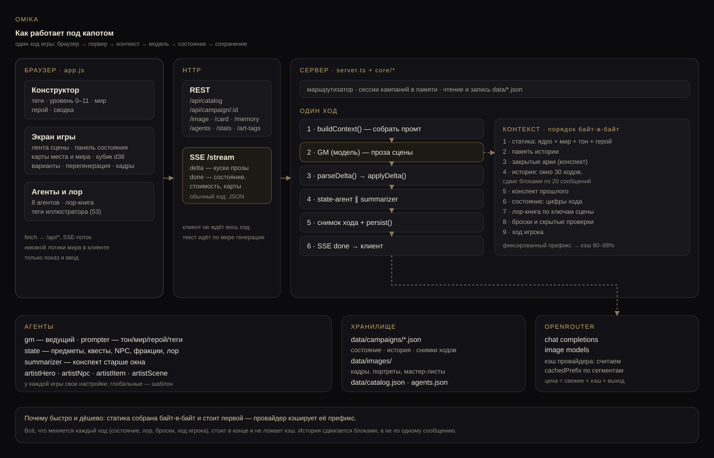

# Архитектура

## Два процесса, а не один

Игра делится на две фазы, и это принципиально.

### Фаза A. Сборка кампании (один раз)

```
теги игрока → генератор МИРА → world.md    ┐
             → генератор ТОНА  → tone.md     ├→ библия кампании (замораживается)
             → генератор ГЕРОЯ → hero.md     ┘
```

Мир и тон — не каталог, а **результат генерации по тегам** в момент старта.
Каталог `Миры\V!` — это примеры и референсы, из них собираются теги и стиль.

После сборки библия иммутабельна. Всё, что меняется дальше, — это состояние и конспект.

### Фаза B. Игровой цикл (каждый ход)

```
ввод игрока
   ↓
сборка контекста (4 слоя, порядок фиксирован)
   ↓
ведущая модель → проза + блок изменений (JSON)
   ↓
валидация изменений (детерминированная) → применение к стейту
   ↓
критик (мелкая модель, позже) → провал → один ретрай
   ↓
запись в лог → снапшот
   ↓
по триггеру: обновление конспекта (append-only)
   ↓
асинхронно: картинка сцены
```

## Слои контекста

Порядок — от самого стабильного к самому изменчивому. Это не стилистика,
а экономика: провайдеры кэшируют префикс, и если динамика стоит в начале,
кэш не работает никогда.

| Слой | Что внутри | Как часто меняется | Кэш |
|---|---|---|---|
| `static` | ядро правил + world.md + tone.md | никогда после старта | попадает всегда |
| `conspect.frozen` | закрытые арки | раз в арку | попадает почти всегда |
| `history` | последние N ходов настоящими сообщениями | только дописывается | попадает |
| `state` | цифры: место, время, деньги, раны, инвентарь | каждый ход | не кэшируется |
| `turn` | ввод игрока | каждый ход | — |

История отдаётся сообщениями `user`/`assistant`, а не одним текстовым
блоком: префикс остаётся байт-в-байт тем же, и кэш провайдера работает.
Состояние стоит **после** истории — оно меняется всегда, значит его место
в хвосте. Закрытие арки ломает кэш на один ход: это осознанная цена,
поэтому арки закрываем редко.

`buildContext()` возвращает сегменты с хешами — по ним видно, что попало в кэш.

## Состояние

Типизированный JSON, а не проза:

- `time`, `place`, `weather` — где и когда;
- `hero.wounds`, `hero.conditions` — тело;
- `money` — три номинала, абсолютные значения;
- `items[]` — с местом нахождения (надето / в сумке / в хранилище / потеряно);
- `party[]`, `npcs[]` — со статусом, связью, ранами;
- `quests[]` — со статусом и шагами;
- `promises[]` — обещания, за которые потом спросят;
- `hiddenFacts[]` — **факты, зафиксированные до того, как стали важны** (механика §0.3);
- `flags` — произвольные переключатели.

Правило: если что-то нельзя проверить — оно не в стейте, а в прозе.

## Конспект

Не «саммари», а растущий документ:

- **закрытые арки** — append-only, никогда не перегенерируются;
- **открытая арка** — пополняется строками по ходам.

Почему так: пересказ пересказа деградирует. Если каждый цикл модель
переписывает весь конспект, через десять циклов детали обрастают
подробностями, которых не было, а однократные факты исчезают.
Append-only это лечит — и заодно держит префикс стабильным.

## Изменения состояния

Модель отдаёт прозу и отдельный JSON-блок. Блок валидируется:

- деньги не уходят в минус;
- нельзя убрать предмет, которого нет;
- серьёзные раны не появляются «просто так» без описания в прозе (позже — модель-критик).

Валидация не «наказывает» модель, а **не даёт испортить стейт**: непрошедшее
изменение отбрасывается, ход продолжается, в лог пишется предупреждение.

## Снапшоты

Полный стейт + конспект на каждый ход — килобайты. Это даёт:

- перемотку на ход назад;
- ветки (умер — продолжаем с развилки);
- отладку: видно, на каком ходу поехали цифры.

## Роли моделей

| Роль | Где | Требование |
|---|---|---|
| Ведущая | API | качество прозы, следование правилам |
| Суммаризатор | локально/дёшево | дисциплина схемы, не фантазия |
| Критик | локально/дёшево | сверка фактов |
| Роутер | код, не модель | детерминированность |
| Эмбеддинги | локально | поиск по леджеру |

Ведущую не каскадируем внутри арки: смена модели = смена голоса.
Дорогая модель — только на событиях (смерть, босс, финал арки).

## Картинки

Промт сцены собирается **из стейта**, а не из прозы: локация, время, погода,
кто присутствует, действие, настроение, стиль. Внешность персонажей —
отдельный замороженный дескриптор + референс. Генерация асинхронная, после
стрима текста.

## Схема



